<!--
  Concept A — animated mechatronics tear-down hero, framed stats, engineering plates, looping GIFs.
  Commit the assets/ folder to the profile repo (ahmedysallam/ahmedysallam) so the relative image paths resolve.
-->

  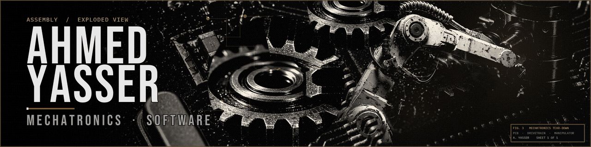
   
  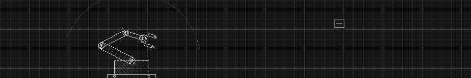

 

  Mechatronics and software engineer working across <b>computer vision</b>, <b>robotics</b>, and <b>embedded systems</b>. 
  I try to stay consistent about learning new tools. 
  The rest of the time is games — until a problem pulls me back in.

  
  
  
  
  
  
  
  

  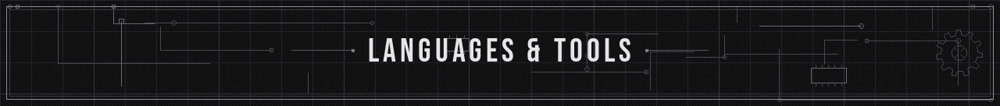
   
  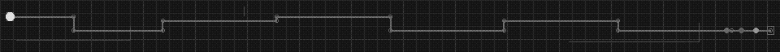

  
  <a href="https://www.gnu.org/software/bash/">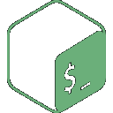</a>
  
  
  
  
  
  
  
  
  
  

  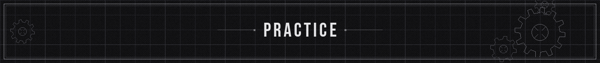
   
  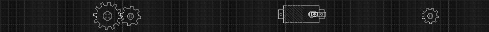
  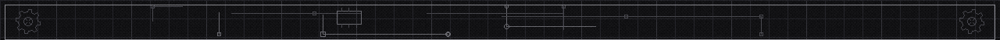
  
  
   
  
  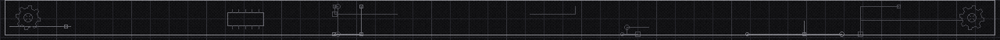

  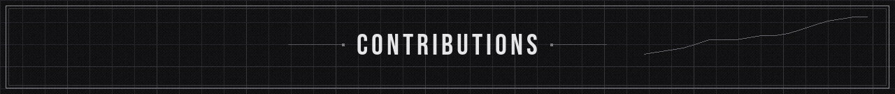
   
  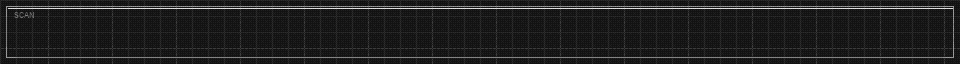
  

  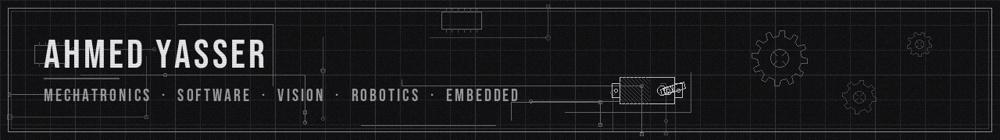

